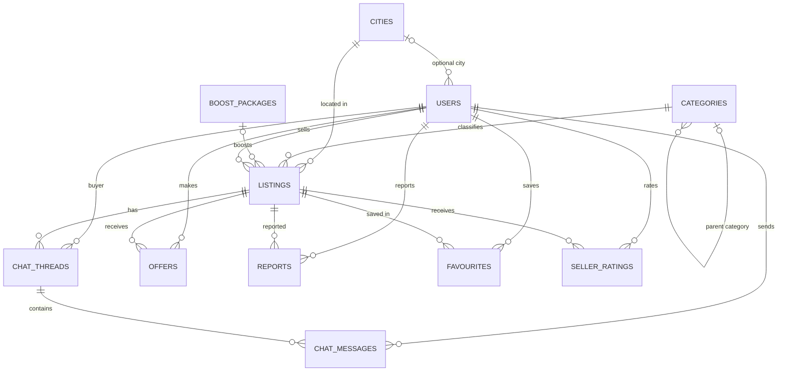

# Phase 2: Schema Design, Constraints, and Normalization

All 11 tables are created inside the `olx` schema using `sql/01_schema.sql` and loaded from `seed_data/` using `sql/02_load_data.sql`.

The schema uses PRIMARY KEY, FOREIGN KEY, UNIQUE, NOT NULL, and CHECK constraints. No secondary performance-tuning indexes are included in Phase 2.

This document describes the current implementation of `sql/01_schema.sql`.

---

## 1. Entity-Relationship Diagram

Rendered diagram: [diagrams/er_diagram.png](../diagrams/er_diagram.png)

### Relationship Cardinalities

- `cities` → `users` (1:N; `users.city_id` is optional).
- `cities` → `listings` (1:N).
- `categories` → `categories` (0..1:N; self-referential parent-child hierarchy).
- `categories` → `listings` (1:N).
- `boost_packages` → `listings` (0..1:N; a listing may have no boost package).
- `users` → `listings` (1:N through `seller_id`).
- `users` ↔ `listings` through `favourites` (M:N).
- `listings` → `chat_threads` (1:N).
- `users` → `chat_threads` (1:N through `buyer_id`).
- `chat_threads` → `chat_messages` (1:N).
- `users` → `chat_messages` (1:N through `sender_id`).
- `listings` → `offers` (1:N).
- `users` → `offers` (1:N through `buyer_id`).
- `listings` → `reports` (1:N).
- `users` → `reports` (1:N through `reporter_id`).
- `listings` → `seller_ratings` (1:N).
- `users` → `seller_ratings` (1:N through `rater_id`).
- `seller_ratings` references `listings` using the composite foreign key `(listing_id, seller_id)`.

### Mermaid ER Diagram



**Composite relationship:** `seller_ratings(listing_id, seller_id)` references `listings(listing_id, seller_id)`. The `seller_id` must therefore match the seller of the referenced listing.

---

## 2. Data Dictionary (All 11 Tables)

### 2.1 cities

**Rows: 10**

| Column | Data Type | Constraints | Why |
|---|---|---|---|
| city_id | INTEGER | PRIMARY KEY | Unique identifier for each city. |
| city_name | VARCHAR(100) | NOT NULL | Stores the city name. |
| state | VARCHAR(100) | NOT NULL | Stores the corresponding state. |

### 2.2 categories

**Rows: 12**

| Column | Data Type | Constraints | Why |
|---|---|---|---|
| category_id | INTEGER | PRIMARY KEY | Unique identifier for each category. |
| category_name | VARCHAR(100) | NOT NULL | Stores the category name. |
| parent_id | INTEGER | NULL, REFERENCES categories(category_id) | Supports parent and sub-category hierarchy. |

### 2.3 boost_packages

**Rows: 6**

| Column | Data Type | Constraints | Why |
|---|---|---|---|
| package_id | INTEGER | PRIMARY KEY | Unique identifier for each boost package. |
| package_name | VARCHAR(100) | NOT NULL, UNIQUE | Prevents duplicate package names. |
| price | NUMERIC(10,2) | NOT NULL, CHECK (price >= 0) | Stores package price without floating-point rounding. |
| duration_days | INTEGER | NOT NULL, CHECK (duration_days > 0) | Ensures a positive package duration. |

### 2.4 users

**Rows: 50,000**

| Column | Data Type | Constraints | Why |
|---|---|---|---|
| user_id | INTEGER | PRIMARY KEY | Unique identifier for each user. |
| full_name | VARCHAR(150) | NOT NULL | Stores the user's name. |
| phone | VARCHAR(20) | NOT NULL, UNIQUE | Provides a unique phone number for each user. |
| email | VARCHAR(255) | NULL, UNIQUE | Optional email address; unique when provided. |
| city_id | INTEGER | NULL, REFERENCES cities(city_id) | Associates a user with a city when available. |
| phone_verified | BOOLEAN | NOT NULL | Stores phone verification status. |
| is_banned | BOOLEAN | NOT NULL | Stores account moderation status. |
| joined_at | TIMESTAMPTZ | NOT NULL | Records when the user joined. |

### 2.5 listings

**Rows: 120,000**

| Column | Data Type | Constraints | Why |
|---|---|---|---|
| listing_id | INTEGER | PRIMARY KEY | Unique identifier for each advertisement. |
| seller_id | INTEGER | NOT NULL, REFERENCES users(user_id) | Identifies the seller who created the listing. |
| category_id | INTEGER | NOT NULL, REFERENCES categories(category_id) | Assigns the listing to a category. |
| title | VARCHAR(255) | NOT NULL | Stores the advertisement headline. |
| description | TEXT | NULL | Stores optional listing details. |
| price | NUMERIC(12,2) | NOT NULL, CHECK (price > 0) | Stores a positive asking price. |
| is_negotiable | BOOLEAN | NOT NULL | Indicates whether the price is negotiable. |
| item_condition | VARCHAR(20) | NOT NULL, CHECK (item_condition IN ('FAIR', 'GOOD', 'LIKE_NEW', 'NEW')) | Restricts condition to supported values. |
| attributes | JSONB | NOT NULL, CHECK (jsonb_typeof(attributes) = 'object') | Stores category-specific product details as a JSON object. |
| city_id | INTEGER | NOT NULL, REFERENCES cities(city_id) | Identifies the listing's city. |
| locality | VARCHAR(150) | NULL | Stores optional neighbourhood information. |
| latitude | NUMERIC(9,6) | NULL, CHECK (latitude IS NULL OR latitude BETWEEN -90 AND 90) | Stores valid geographic latitude when available. |
| longitude | NUMERIC(9,6) | NULL, CHECK (longitude IS NULL OR longitude BETWEEN -180 AND 180) | Stores valid geographic longitude when available. |
| image_count | INTEGER | NOT NULL, CHECK (image_count >= 0) | Stores the number of listing images. |
| view_count | INTEGER | NOT NULL, CHECK (view_count >= 0) | Stores a non-negative view counter. |
| boost_package_id | INTEGER | NULL, REFERENCES boost_packages(package_id) | Identifies an optional paid boost package. |
| status | VARCHAR(20) | NOT NULL, CHECK (status IN ('ACTIVE', 'EXPIRED', 'REMOVED', 'SOLD')) | Restricts listing lifecycle status. |
| posted_at | TIMESTAMPTZ | NOT NULL | Records when the listing was posted. |
| expires_at | TIMESTAMPTZ | NOT NULL, CHECK (expires_at > posted_at) | Ensures expiry occurs after posting. |
| sold_at | TIMESTAMPTZ | NULL, CHECK (sold_at IS NULL OR sold_at >= posted_at) | Records the sale time when applicable. |

**Additional constraints:**

| Constraint | Purpose |
|---|---|
| UNIQUE (listing_id, seller_id) | Supports the composite foreign key from `seller_ratings`. |
| CHECK on status and sold_at | Requires `sold_at` when status is SOLD and requires it to be NULL otherwise. |

### 2.6 chat_threads

**Rows: 59,855**

| Column | Data Type | Constraints | Why |
|---|---|---|---|
| thread_id | INTEGER | PRIMARY KEY | Unique conversation identifier. |
| listing_id | INTEGER | NOT NULL, REFERENCES listings(listing_id) | Identifies the advertisement being discussed. |
| buyer_id | INTEGER | NOT NULL, REFERENCES users(user_id) | Identifies the buyer in the conversation. |
| created_at | TIMESTAMPTZ | NOT NULL | Records conversation creation time. |

**Additional constraint:**

`UNIQUE (listing_id, buyer_id)` prevents duplicate conversation threads for the same buyer and listing.

### 2.7 chat_messages

**Rows: 209,529**

| Column | Data Type | Constraints | Why |
|---|---|---|---|
| message_id | INTEGER | PRIMARY KEY | Unique identifier for each message. |
| thread_id | INTEGER | NOT NULL, REFERENCES chat_threads(thread_id) | Links a message to its conversation. |
| sender_id | INTEGER | NOT NULL, REFERENCES users(user_id) | Identifies the message sender. |
| body | TEXT | NOT NULL | Stores message content. |
| sent_at | TIMESTAMPTZ | NOT NULL | Records the message timestamp. |
| is_read | BOOLEAN | NOT NULL | Tracks whether the message has been read. |

### 2.8 offers

**Rows: 19,943**

| Column | Data Type | Constraints | Why |
|---|---|---|---|
| offer_id | INTEGER | PRIMARY KEY | Unique identifier for each offer. |
| listing_id | INTEGER | NOT NULL, REFERENCES listings(listing_id) | Identifies the listing receiving the offer. |
| buyer_id | INTEGER | NOT NULL, REFERENCES users(user_id) | Identifies the buyer making the offer. |
| offer_price | NUMERIC(12,2) | NOT NULL, CHECK (offer_price > 0) | Ensures the offered amount is positive. |
| status | VARCHAR(20) | NOT NULL, CHECK (status IN ('ACCEPTED', 'COUNTERED', 'PENDING', 'REJECTED')) | Restricts offer status to supported values. |
| created_at | TIMESTAMPTZ | NOT NULL | Records when the offer was created. |
| responded_at | TIMESTAMPTZ | NULL | Stores the response timestamp when the offer is answered. |

**Additional constraint:**

A PENDING offer must have `responded_at IS NULL`. Other offer statuses must have a response timestamp.

### 2.9 favourites

**Rows: 70,000**

| Column | Data Type | Constraints | Why |
|---|---|---|---|
| user_id | INTEGER | NOT NULL, REFERENCES users(user_id) | Identifies the user saving the listing. |
| listing_id | INTEGER | NOT NULL, REFERENCES listings(listing_id) | Identifies the saved listing. |
| saved_at | TIMESTAMPTZ | NOT NULL | Records when the listing was saved. |

**Primary key:** `PRIMARY KEY (user_id, listing_id)`

The composite primary key prevents a user from saving the same listing more than once.

### 2.10 reports

**Rows: 7,999**

| Column | Data Type | Constraints | Why |
|---|---|---|---|
| report_id | INTEGER | PRIMARY KEY | Unique moderation report identifier. |
| listing_id | INTEGER | NOT NULL, REFERENCES listings(listing_id) | Identifies the reported listing. |
| reporter_id | INTEGER | NOT NULL, REFERENCES users(user_id) | Identifies the user submitting the report. |
| reason | VARCHAR(30) | NOT NULL, CHECK (reason IN ('ALREADY_SOLD', 'FRAUD', 'OFFENSIVE', 'SPAM', 'WRONG_CATEGORY')) | Restricts reports to supported reasons. |
| created_at | TIMESTAMPTZ | NOT NULL | Records when the report was submitted. |
| status | VARCHAR(20) | NOT NULL, CHECK (status IN ('ACTIONED', 'DISMISSED', 'OPEN')) | Tracks moderation progress. |

**Additional constraint:**

`UNIQUE (listing_id, reporter_id)` prevents the same user from reporting the same listing more than once.

### 2.11 seller_ratings

**Rows: 11,244**

| Column | Data Type | Constraints | Why |
|---|---|---|---|
| rating_id | INTEGER | PRIMARY KEY | Unique rating identifier. |
| seller_id | INTEGER | NOT NULL | Identifies the seller being rated. |
| rater_id | INTEGER | NOT NULL, REFERENCES users(user_id) | Identifies the user submitting the rating. |
| listing_id | INTEGER | NOT NULL | Identifies the listing associated with the rating. |
| stars | INTEGER | NOT NULL, CHECK (stars BETWEEN 1 AND 5) | Restricts ratings to a 1–5 star scale. |
| comment | TEXT | NULL | Stores optional written feedback. |
| created_at | TIMESTAMPTZ | NOT NULL | Records when the rating was created. |

**Additional constraints:**

- `FOREIGN KEY (listing_id, seller_id) REFERENCES listings(listing_id, seller_id)`
- `UNIQUE (listing_id, rater_id)`
- `CHECK (seller_id <> rater_id)`

The composite foreign key ensures that the seller being rated is the seller associated with that listing.

---

## 3. Foreign Key ON DELETE Policy and Nullable Columns

### 3.1 Foreign Key ON DELETE Policy

No explicit `ON DELETE` action is defined in the current `sql/01_schema.sql`. PostgreSQL therefore applies its default `NO ACTION` behaviour to all foreign keys.

| Referencing Table | Foreign Key | Referenced Table | ON DELETE |
|---|---|---|---|
| categories | parent_id | categories(category_id) | NO ACTION |
| users | city_id | cities(city_id) | NO ACTION |
| listings | seller_id | users(user_id) | NO ACTION |
| listings | category_id | categories(category_id) | NO ACTION |
| listings | city_id | cities(city_id) | NO ACTION |
| listings | boost_package_id | boost_packages(package_id) | NO ACTION |
| chat_threads | listing_id | listings(listing_id) | NO ACTION |
| chat_threads | buyer_id | users(user_id) | NO ACTION |
| chat_messages | thread_id | chat_threads(thread_id) | NO ACTION |
| chat_messages | sender_id | users(user_id) | NO ACTION |
| offers | listing_id | listings(listing_id) | NO ACTION |
| offers | buyer_id | users(user_id) | NO ACTION |
| favourites | user_id | users(user_id) | NO ACTION |
| favourites | listing_id | listings(listing_id) | NO ACTION |
| reports | listing_id | listings(listing_id) | NO ACTION |
| reports | reporter_id | users(user_id) | NO ACTION |
| seller_ratings | rater_id | users(user_id) | NO ACTION |
| seller_ratings | (listing_id, seller_id) | listings(listing_id, seller_id) | NO ACTION |

### 3.2 Why Specific Columns Allow NULL

| Table | Column | Business Explanation |
|---|---|---|
| categories | parent_id | Top-level categories do not have a parent category. |
| users | email | A user can register without providing an email address. |
| users | city_id | A user's city information is optional. |
| listings | description | A listing can be created without a written description. |
| listings | locality | Neighbourhood information is optional. |
| listings | latitude | Geographic coordinates may not be available. |
| listings | longitude | Geographic coordinates may not be available. |
| listings | boost_package_id | A listing can exist without purchasing a boost. |
| listings | sold_at | Only sold listings have a sale timestamp. |
| offers | responded_at | Pending offers have not received a response. |
| seller_ratings | comment | A user can submit a star rating without written feedback. |

The remaining columns are defined as NOT NULL or are primary key columns.

---

## 4. Automatic Indexes Present in Baseline (Phase 2)

PostgreSQL automatically creates unique B-tree indexes for PRIMARY KEY and UNIQUE constraints.

Based on the current schema, **18 automatic indexes are expected**.

| Table | Index Name | Indexed Column(s) |
|---|---|---|
| cities | cities_pkey | city_id |
| categories | categories_pkey | category_id |
| boost_packages | boost_packages_pkey | package_id |
| boost_packages | boost_packages_package_name_key | package_name |
| users | users_pkey | user_id |
| users | users_phone_key | phone |
| users | users_email_key | email |
| listings | listings_pkey | listing_id |
| listings | listings_listing_id_seller_id_key | (listing_id, seller_id) |
| chat_threads | chat_threads_pkey | thread_id |
| chat_threads | chat_threads_listing_id_buyer_id_key | (listing_id, buyer_id) |
| chat_messages | chat_messages_pkey | message_id |
| offers | offers_pkey | offer_id |
| favourites | favourites_pkey | (user_id, listing_id) |
| reports | reports_pkey | report_id |
| reports | reports_listing_id_reporter_id_key | (listing_id, reporter_id) |
| seller_ratings | seller_ratings_pkey | rating_id |
| seller_ratings | seller_ratings_listing_id_rater_id_key | (listing_id, rater_id) |

### Index Verification

The following query lists the indexes created in the `olx` schema:

```sql
SELECT
    tablename,
    indexname,
    indexdef
FROM pg_indexes
WHERE schemaname = 'olx'
ORDER BY tablename, indexname;
```

To count them:

```sql
SELECT COUNT(*) AS total_indexes
FROM pg_indexes
WHERE schemaname = 'olx';
```

Expected count: **18 indexes**.

No secondary performance-tuning indexes have been added in Phase 2.

---

## 5. Normalization and Functional Dependencies (3NF / BCNF)

### 5.1 Functional Dependencies and Candidate Keys

| Table | Candidate Keys | Non-Trivial Functional Dependencies | Normal Form |
|---|---|---|---|
| cities | city_id | city_id → city_name, state | BCNF |
| categories | category_id | category_id → category_name, parent_id | BCNF |
| boost_packages | package_id, package_name | package_id → package_name, price, duration_days; package_name → package_id, price, duration_days | BCNF |
| users | user_id, phone | user_id → all user attributes; phone → all user attributes | BCNF |
| listings | listing_id | listing_id → all remaining listing attributes | BCNF |
| chat_threads | thread_id, (listing_id, buyer_id) | thread_id → listing_id, buyer_id, created_at; (listing_id, buyer_id) → thread_id, created_at | BCNF |
| chat_messages | message_id | message_id → thread_id, sender_id, body, sent_at, is_read | BCNF |
| offers | offer_id | offer_id → listing_id, buyer_id, offer_price, status, created_at, responded_at | BCNF |
| favourites | (user_id, listing_id) | (user_id, listing_id) → saved_at | BCNF |
| reports | report_id, (listing_id, reporter_id) | report_id → all report attributes; (listing_id, reporter_id) → all report attributes | BCNF |
| seller_ratings | rating_id, (listing_id, rater_id) | rating_id → all rating attributes; (listing_id, rater_id) → all rating attributes | Intentional redundancy; see below |

`users.email` is nullable and UNIQUE. It is an alternate unique identifier when provided, but it is not treated as a candidate key for every user because NULL values are permitted.

### 5.2 Normalization Assessment

| Normal Form | Assessment |
|---|---|
| 1NF | Relational columns store individual values. `listings.attributes` uses JSONB for category-specific product details. |
| 2NF | The composite primary key of `favourites` determines its non-key attribute `saved_at`; no partial dependency exists there. |
| 3NF | Entity information is separated into the appropriate tables. `seller_ratings.seller_id` introduces a cross-table redundancy because the listing already identifies its seller. |
| BCNF | The other tables satisfy BCNF under their declared functional dependencies. The seller-rating redundancy is discussed separately. |

### 5.3 Derived and Redundant Columns Assessment

| Column / Relationship | Assessment | Reason |
|---|---|---|
| listings.view_count | Derived counter | Stores the accumulated number of views instead of requiring view-event records, which are not stored in this schema. |
| seller_ratings.seller_id | Cross-table redundancy | The listing already identifies its seller. The composite foreign key ensures the stored seller matches the listing's seller. |
| chat_threads and listings.seller_id | Normalized relationship | `chat_threads` stores the buyer and listing; the seller can be obtained through `listings.seller_id`. |

**seller_ratings note:** `seller_id` is retained to associate each rating directly with the seller. The composite foreign key prevents a rating from identifying a seller different from the listing's actual seller. This is an intentional storage redundancy.

---

## 6. Load Verification and Data Integrity Checks

### 6.1 Row Count Verification

All 11 CSV files were imported using `sql/02_load_data.sql`.

| Table | Imported Rows | Result |
|---|---:|---|
| cities | 10 | PASS |
| categories | 12 | PASS |
| boost_packages | 6 | PASS |
| users | 50,000 | PASS |
| listings | 120,000 | PASS |
| chat_threads | 59,855 | PASS |
| chat_messages | 209,529 | PASS |
| offers | 19,943 | PASS |
| favourites | 70,000 | PASS |
| reports | 7,999 | PASS |
| seller_ratings | 11,244 | PASS |
| **Total** | **568,588** | **PASS** |

All imported row counts matched the expected dataset counts.

### 6.2 Data Integrity Checks

The following three additional business-rule checks were executed after data loading.

| Check | Validation | Violations | Result |
|---|---|---:|---|
| buyer_chats_own_ad | A buyer cannot create a chat thread for their own listing. | 0 | PASS |
| invalid_msg_sender | A message sender must be the buyer or seller associated with the conversation. | 0 | PASS |
| sold_before_posted | A listing cannot be sold before it was posted. | 0 | PASS |

All three checks returned zero violations.

### 6.3 Data Problems Discovered

The three additional integrity checks performed did not identify any violations.

The following cross-table business rules are not enforced by the current row-level CHECK constraints and would require separate validation:

| Business Rule | Reason |
|---|---|
| A user should not favourite their own listing. | Requires comparing `favourites.user_id` with `listings.seller_id`. |
| A buyer should not create a conversation about their own listing. | Requires comparing `chat_threads.buyer_id` with `listings.seller_id`. |
| A message sender must be a conversation participant. | Requires comparing `chat_messages.sender_id` with the buyer and listing seller. |

The three executed integrity checks are documented above. Other data-quality conditions have not been reported as verified in this run.

### 6.4 Final Load Verification

- All 11 tables were created successfully in the `olx` schema.
- All 11 CSV files were imported successfully.
- A total of 568,588 records were loaded.
- All expected row counts matched the imported counts.
- `ANALYZE` executed successfully after data loading.
- All three executed integrity checks returned zero violations.

**Phase 2 schema creation, data loading, and the three recorded integrity checks completed successfully.**